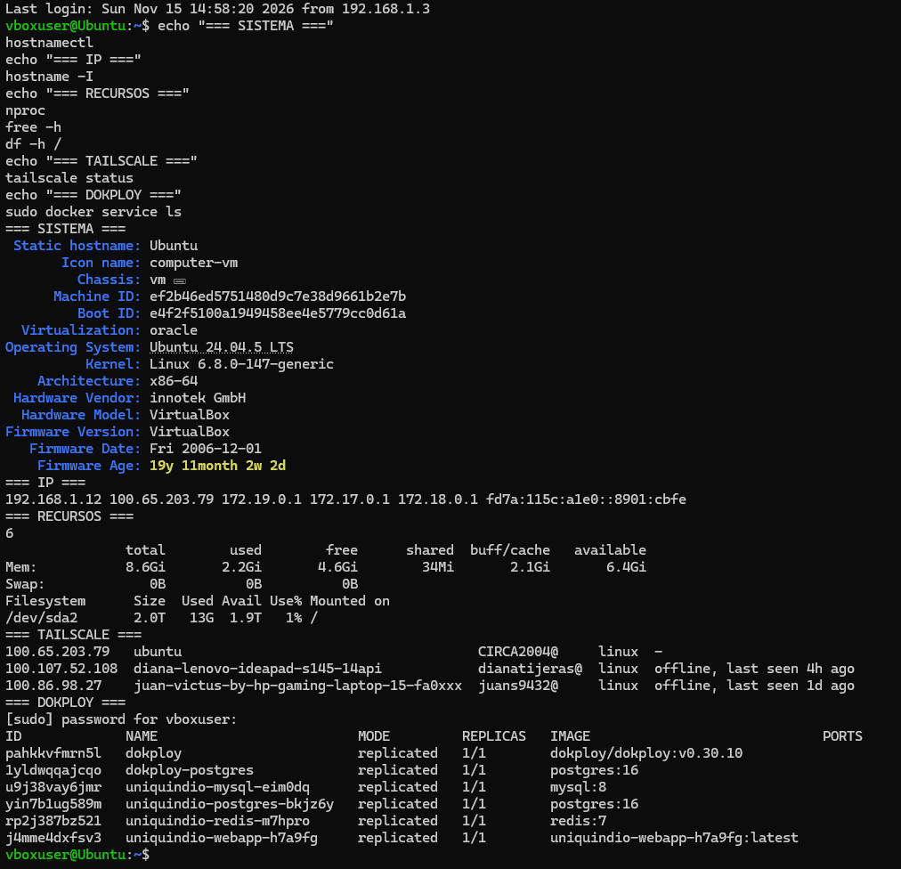
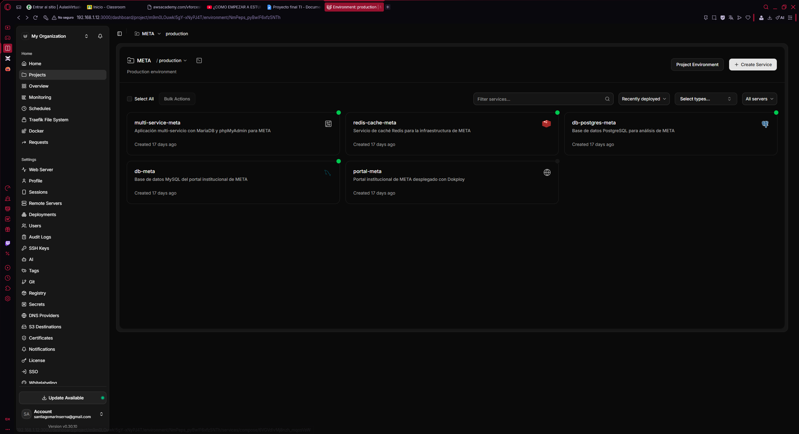
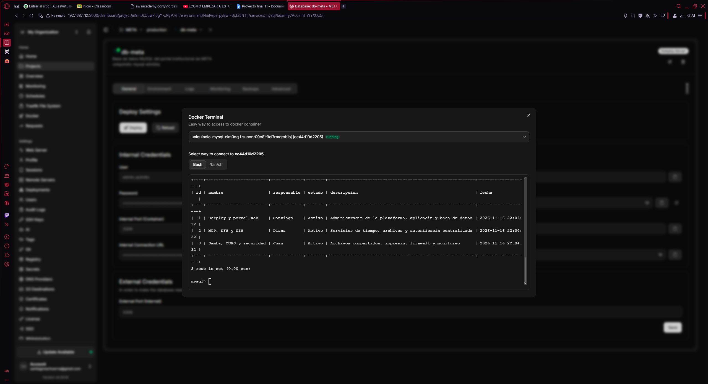
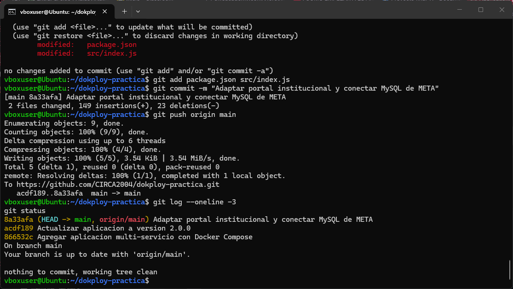
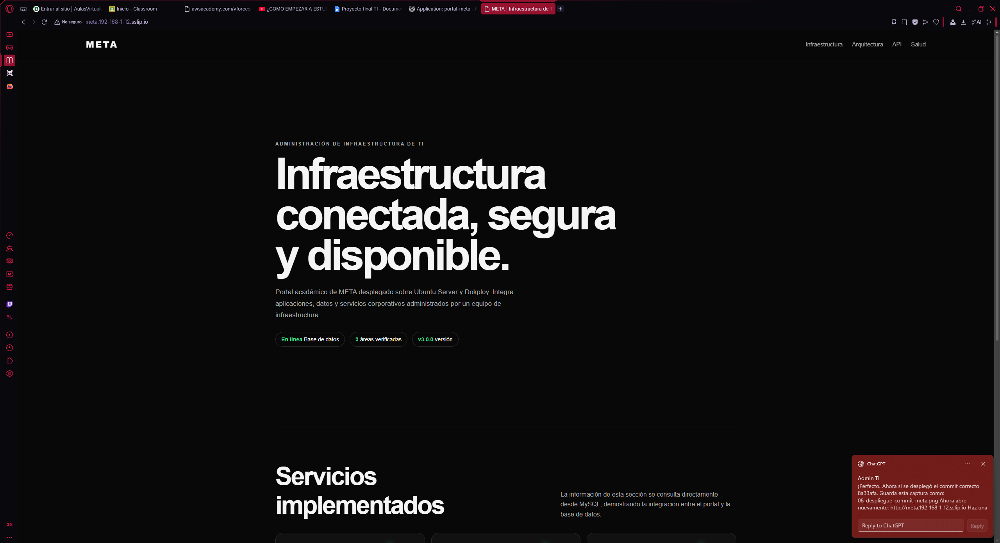
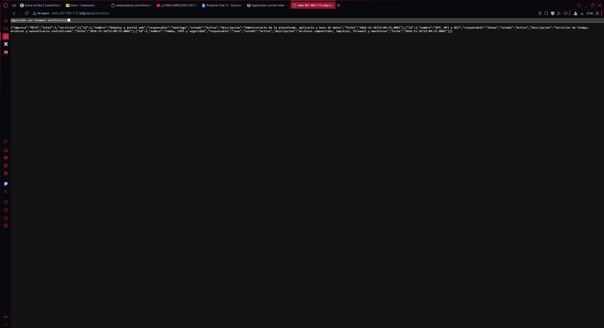
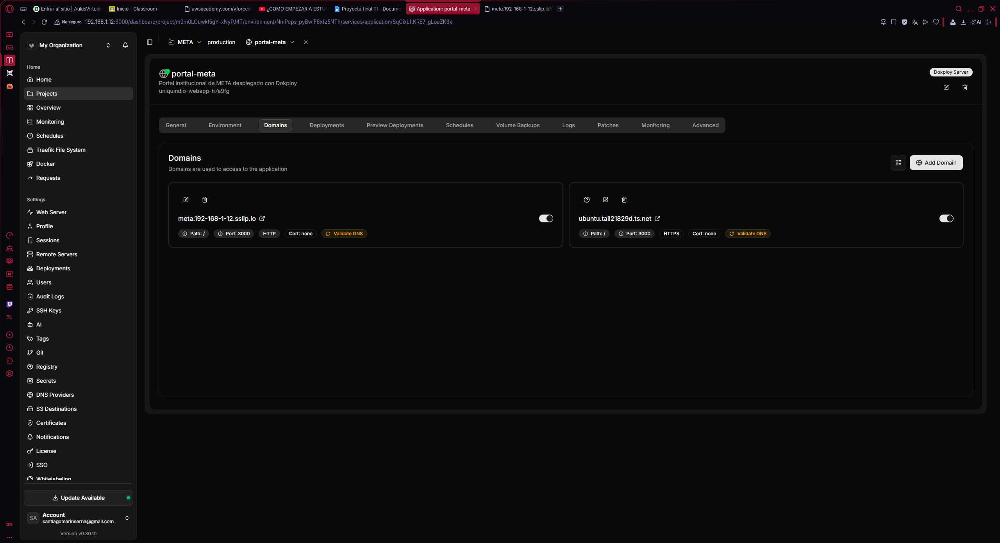
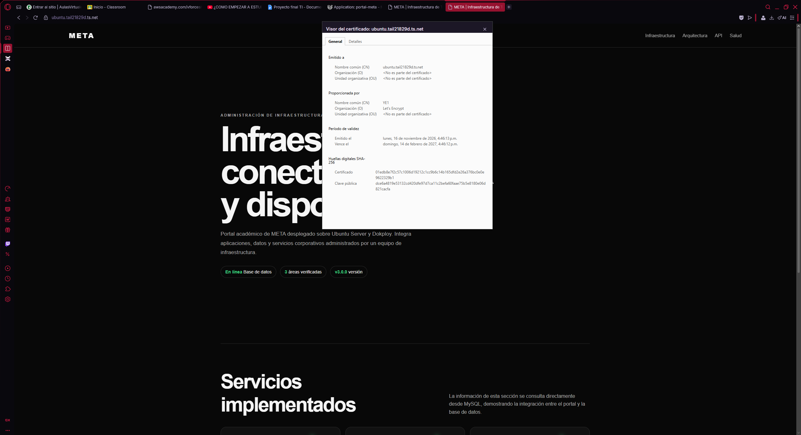

# Implementación de Dokploy y portal institucional de META

## Responsable

**Santiago Marín Serna**

## Descripción

Esta sección documenta la preparación del servidor Ubuntu, la administración de servicios con Dokploy, la integración del portal institucional con MySQL y la publicación privada mediante Tailscale y HTTPS.

## Preparación y validación del servidor

Se comprobó el funcionamiento del servidor Ubuntu, la conectividad local y privada mediante Tailscale, y la disponibilidad de Docker y Dokploy. El equipo quedó identificado con la dirección local `192.168.1.12` y la dirección privada de Tailscale `100.65.203.79`.

## Organización de servicios en Dokploy

Se creó el proyecto **META** en el entorno `production` y se organizaron los servicios `multi-service-meta`, `redis-cache-meta`, `db-postgres-meta`, `db-meta` y `portal-meta`.

## Configuración de la base de datos MySQL

Se utilizó el servicio `db-meta` y se creó la base de datos `meta_db`. En ella se configuró la tabla `servicios` con los campos `id`, `nombre`, `responsable`, `estado`, `descripcion` y `fecha`. Se registraron los tres componentes principales del proyecto y sus responsables.

## Integración con GitHub

El portal fue adaptado como sitio institucional de META, conectado a MySQL mediante variables de entorno y preparado para ejecutarse en el puerto `3000`. Los cambios se publicaron en el repositorio `CIRCA2004/dokploy-practica`, rama `main`, mediante el commit `8a33afa`.

## Despliegue del portal institucional

Dokploy descargó el código desde GitHub, construyó la imagen y desplegó correctamente la aplicación `portal-meta`. El sitio muestra el estado de la infraestructura, la versión `3.0.0` y los servicios consultados desde MySQL.

## Validación de la API

Se verificó el endpoint `/api/servicios`, que devolvió los tres servicios almacenados en MySQL. También se comprobó `/health`, obteniendo estado saludable, base de datos conectada y versión `3.0.0`.

## Acceso privado con Tailscale y HTTPS

Se habilitaron MagicDNS y los certificados HTTPS en la red Tailscale. El certificado para `ubuntu.tail21829d.ts.net` se cargó en Dokploy con el nombre `meta-tailscale-tls` y el dominio se vinculó al portal en el puerto interno `3000`.

## Validación final

Desde un equipo conectado a la misma red Tailscale se accedió a `https://ubuntu.tail21829d.ts.net`. El navegador mostró conexión segura y un certificado de Let's Encrypt emitido para el dominio correcto, con vigencia hasta el 14 de febrero de 2027.

## Endpoints disponibles

- `/`: portal institucional de META.
- `/api/servicios`: listado de servicios almacenados en MySQL.
- `/health`: estado de la aplicación y conexión con la base de datos.
- `/info`: información general del portal.

> Por seguridad, este repositorio no incluye contraseñas, claves privadas, certificados ni archivos `.env`.
