# Documentación Técnica — Servicios Compartidos, Impresión y Seguridad (META)

**Responsable:** Juan  
**Sistema Operativo Servidor:** Ubuntu Server (`192.168.1.18` / VPN `100.65.203.79`)  
**Estación Cliente de Pruebas:** Linux Mint (`juan-Victus-by-HP-Gaming-Laptop`)

---

## 1. Implementación de Samba (Compartición de Archivos Multiplataforma)

### 1.1 Instalación y Configuración de Permisos
Se instalaron los paquetes `samba` y `smbclient`, se creó el grupo de seguridad `sambausers` y se configuró el directorio `/srv/samba/meta` con el bit **SGID (`2775`)** para garantizar la herencia de grupo en todos los archivos creados por los colaboradores:

```bash
sudo apt update && sudo apt install samba smbclient -y
sudo groupadd -f sambausers
sudo mkdir -p /srv/samba/meta
sudo chown -R root:sambausers /srv/samba/meta
sudo chmod -R 2775 /srv/samba/meta
sudo usermod -aG sambausers $USER
sudo smbpasswd -a $USER
```

### 1.2 Declaración del Recurso Compartido (`/etc/samba/smb.conf`)
Se anexó el bloque `[meta]` restringiendo el acceso exclusivamente a usuarios autenticados del grupo `@sambausers`:

```ini
[meta]
   comment = Carpeta Compartida Corporativa META
   path = /srv/samba/meta
   browseable = yes
   writable = yes
   guest ok = no
   valid users = @sambausers
   create mask = 0664
   directory mask = 2775
```

### 1.3 Validación y Activación del Servicio
```bash
testparm -s
sudo systemctl enable --now smbd nmbd
sudo systemctl status smbd nmbd --no-pager
```

* **Evidencia:**  
  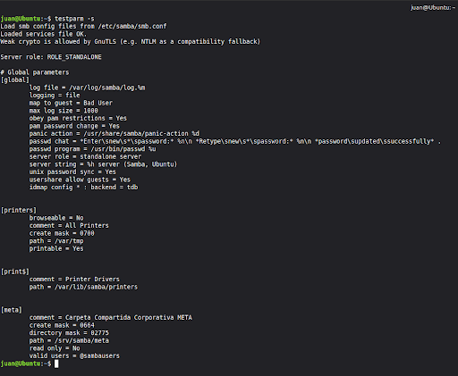

---

## 2. Implementación de CUPS (Servidor de Impresión en Red)

### 2.1 Instalación y Habilitación de Acceso Remoto
Se instaló `cups` junto con el controlador de impresora virtual `printer-driver-cups-pdf`. Posteriormente se modificó `/etc/cups/cupsd.conf` para escuchar en todas las interfaces (`0.0.0.0:631`) y permitir administración remota desde la red:

```bash
sudo apt install cups printer-driver-cups-pdf -y
sudo usermod -aG lpadmin $USER
sudo cp /etc/cups/cupsd.conf /etc/cups/cupsd.conf.bak

sudo sed -i 's/Listen localhost:631/Listen 0.0.0.0:631/' /etc/cups/cupsd.conf
sudo sed -i '/Listen 0.0.0.0:631/a ServerAlias *' /etc/cups/cupsd.conf
sudo sed -i '/<Location \/>/,/<\/Location>/ s/Order allow,deny/Order allow,deny\n  Allow all/' /etc/cups/cupsd.conf
sudo sed -i '/<Location \/admin>/,/<\/Location>/ s/Order allow,deny/Order allow,deny\n  Allow all/' /etc/cups/cupsd.conf
sudo sed -i '/<Location \/admin\/conf>/,/<\/Location>/ s/Order allow,deny/Order allow,deny\n  Allow all/' /etc/cups/cupsd.conf

sudo systemctl enable --now cups && sudo systemctl restart cups
```

### 2.2 Verificación del Servicio
```bash
sudo systemctl status cups --no-pager && ss -tulpn | grep 631
```

* **Evidencia:**  
  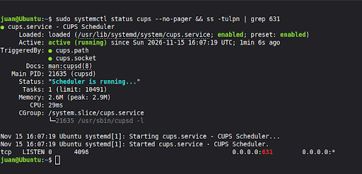

---

## 3. Automatización de Copias de Seguridad (`backup_meta.sh` + `cron`)

Se implementó el script `/usr/local/bin/backup_meta.sh` encargado de comprimir diariamente en `/var/backups/meta` los datos compartidos de Samba (`/srv/samba/meta`) y los archivos de configuración (`/etc/samba`, `/etc/cups`, `/etc/ufw`), aplicando rotación automática de archivos mayores a 7 días:

```bash
#!/bin/bash
FECHA=$(date +%Y%m%d_%H%M%S)
DEST="/var/backups/meta"
LOG="/var/log/backup_meta.log"

mkdir -p "$DEST"

tar -czf "$DEST/samba_meta_$FECHA.tar.gz" /srv/samba/meta 2>/dev/null
tar -czf "$DEST/configs_meta_$FECHA.tar.gz" /etc/samba /etc/cups /etc/ufw 2>/dev/null

find "$DEST" -type f -name "*.tar.gz" -mtime +7 -delete
echo "[$FECHA] Respaldo completado exitosamente en $DEST" >> "$LOG"
```

Se programó en el `crontab` de `root` para ejecutarse todos los días a las `02:00 AM`:
```bash
0 2 * * * /usr/local/bin/backup_meta.sh
```

* **Evidencia:**  
  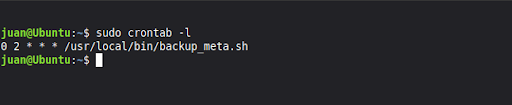

---

## 4. Monitoreo y Auditoría de Registros (`monitoreo_meta.sh`)

Se desarrolló `/usr/local/bin/monitoreo_meta.sh` para verificar la disponibilidad de los demonios `smbd`, `nmbd`, `cups` y `ufw`, registrar alertas ante caídas en `/var/log/monitoreo_meta.log`, consultar conexiones Samba (`smbstatus -b`) e inspeccionar registros mediante `journalctl`:

```bash
#!/bin/bash
LOG_ALERTAS="/var/log/monitoreo_meta.log"
FECHA=$(date "+%Y-%m-%d %H:%M:%S")

echo "=== REPORTE DE ESTADO META ($FECHA) ==="
for SERVICIO in smbd nmbd cups ufw; do
    if systemctl is-active --quiet "$SERVICIO"; then
        echo "[OK] Servicio $SERVICIO activo."
    else
        echo "[$FECHA] [ALERTA] Servicio $SERVICIO CAÍDO." | tee -a "$LOG_ALERTAS"
    fi
done

echo -e "\n--- Sesiones Samba Activas ---"
sudo smbstatus -b 2>/dev/null

echo -e "\n--- Últimos eventos de Samba y CUPS (journalctl) ---"
journalctl -u smbd -u cups -n 10 --no-pager
```

Se automatizó su ejecución cada 15 minutos en el `crontab` de `root` (`*/15 * * * *`).

* **Evidencia:**  
  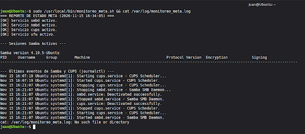

---

## 5. Seguridad Perimetral con Firewall UFW

Se configuraron políticas restrictivas por defecto (`deny incoming` / `allow outgoing`) habilitando únicamente los puertos de la infraestructura y los segmentos de red local (`192.168.0.0/16`) y VPN Tailscale (`100.64.0.0/10`) para garantizar la interoperabilidad con los servicios RPC de NFS y NIS:

```bash
sudo ufw default deny incoming
sudo ufw default allow outgoing
sudo ufw allow 22/tcp
sudo ufw allow 80,443/tcp
sudo ufw allow 631/tcp
sudo ufw allow 139,445/tcp
sudo ufw allow 137,138/udp
sudo ufw allow 123/udp
sudo ufw allow from 192.168.0.0/16
sudo ufw allow from 100.64.0.0/10
sudo ufw --force enable
sudo ufw status verbose
```

* **Evidencia:**  
  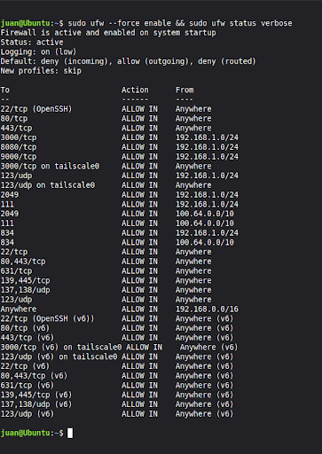

---

## 6. Pruebas de Verificación desde Cliente (Linux Mint)

1. **Conectividad HTTPS hacia CUPS:**
   ```bash
   curl -kI [https://100.65.203.79:631](https://100.65.203.79:631)
   ```
   Se obtuvo respuesta `HTTP/1.1 200 OK` desde `Server: CUPS/2.4 IPP/2.1` y se ejecutó la impresión de página de prueba (*Print Test Page*) en la impresora virtual `PDF`.
2. **Conectividad y Escritura en Samba:**
   ```bash
   smbclient //100.65.203.79/meta -U juan
   ```
   Se autenticó con éxito, transfiriendo y listando archivos en el recurso compartido remoto.

* **Evidencias:**  
  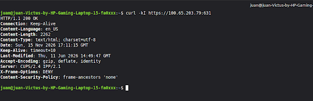  
  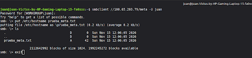

---

## 7. Solución de Problemas Encontrados

| Problema Identificado | Causa Raíz | Solución Aplicada |
| :--- | :--- | :--- |
| **Acceso web remoto a CUPS rechazado (`403 Forbidden` / `400 Bad Request`)** | Por defecto CUPS solo escucha en `localhost:631` y rechaza peticiones cuyo encabezado `Host` sea una IP externa. | Se cambió la escucha a `Listen 0.0.0.0:631`, se agregó `ServerAlias *` y se incluyó `Allow all` en las directivas `<Location>` de `/etc/cups/cupsd.conf`. |
| **Riesgo de bloqueo sobre servicios RPC (NFS/NIS) al activar UFW** | NFS y NIS negocian puertos dinámicos mediante `rpcbind`, por lo que abrir puertos estáticos individuales bloqueaba la comunicación desde clientes VPN y LAN. | Se autorizó el tráfico interno proveniente de los segmentos `192.168.0.0/16` (LAN bridged) y `100.64.0.0/10` (red VPN Tailscale) manteniendo el bloqueo por defecto hacia el exterior. |
| **Ausencia inicial de `/var/log/monitoreo_meta.log`** | El script de monitoreo escribe en el archivo de alertas únicamente cuando un servicio se encuentra detenido (`else`). | Se documentó el comportamiento esperado: al estar los 4 demonios activos (`[OK]`), el reporte se visualiza en salida estándar y `journalctl`, creándose el log solo ante incidencias reales. |


# Documentación Técnica — Servicios Base de Red Linux: NTP, NFS y NIS (META)

**Responsable:** Diana  
**Sistema Operativo Servidor:** Ubuntu Server 24.04 LTS (`192.168.1.18` / VPN `100.65.203.79`)  
**Estación Cliente de Pruebas:** Linux Mint (`diana-Lenovo-IdeaPad-S145-14API` / VPN `100.107.52.108`)

---

## 1. Implementación de NTP (Sincronización Horaria)

### 1.1 Instalación y Configuración de Permisos de Red (`/etc/ntpsec/ntp.conf`)
Se actualizó el índice de paquetes en Ubuntu Server 24.04 e instaló el servicio `ntp` (implementado mediante `ntpsec`). Posteriormente, se añadieron las directivas `restrict` para autorizar consultas de tiempo desde la red local (`192.168.1.0/24`) y la VPN corporativa (`100.64.0.0/10`), bloqueando modificaciones remotas mediante `nomodify notrap`:

```bash
sudo apt update && sudo apt install ntp -y
echo "restrict 192.168.1.0 mask 255.255.255.0 nomodify notrap" | sudo tee -a /etc/ntpsec/ntp.conf
echo "restrict 100.64.0.0 mask 255.192.0.0 nomodify notrap" | sudo tee -a /etc/ntpsec/ntp.conf
sudo systemctl restart ntpsec
```

### 1.2 Validación y Sincronización en Servidor y Cliente
En el servidor se comprobó la sincronización primaria (`*`) con el nodo `0.co.ntp.edgeuno.c` (estrato 2, latencia de `15.63 ms`), estabilizando el reloj central en **estrato 3** (`leap=00`, `rootdisp=298.481 ms`). Desde el cliente Linux Mint se consultó la hora oficial confirmando un desfase (*offset*) de `-0.132436` segundos:

```bash
# Verificación en servidor Ubuntu
sudo ntpq -p
ntpq -c rv | grep -E "leap|stratum|rootdisp"

# Validación desde cliente Linux Mint
sudo ntpdate -qu 100.65.203.79
```

* **Evidencias:**  
  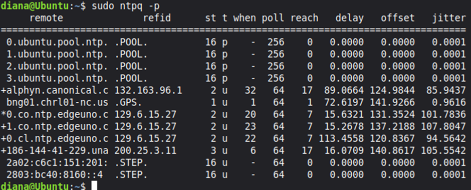  
  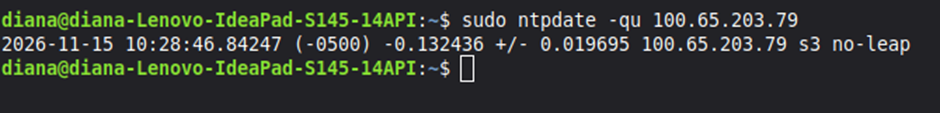

---

## 2. Implementación de NFS (Compartición de Archivos en Linux)

### 2.1 Instalación y Configuración del Directorio Compartido
Se instaló el paquete `nfs-kernel-server` y se creó el directorio colaborativo `/srv/nfs/meta_dev` asignando propiedad a `nobody:nogroup` y permisos de lectura y escritura:

```bash
sudo apt update && sudo apt install nfs-kernel-server -y
sudo mkdir -p /srv/nfs/meta_dev
sudo chown nobody:nogroup /srv/nfs/meta_dev
sudo chmod 777 /srv/nfs/meta_dev
```

### 2.2 Declaración de Exportaciones (`/etc/exports`) y Reglas UFW
Se publicó el recurso compartido hacia ambas subredes corporativas y se aseguraron los puertos `2049` (NFS) y `111` (rpcbind) en el cortafuegos UFW:

```ini
/srv/nfs/meta_dev 192.168.1.0/24(rw,sync,no_root_squash)
/srv/nfs/meta_dev 100.64.0.0/10(rw,sync,no_root_squash)
```

```bash
sudo exportfs -ra && sudo systemctl restart nfs-kernel-server && sudo exportfs -v

sudo ufw allow from 192.168.1.0/24 to any port 2049
sudo ufw allow from 192.168.1.0/24 to any port 111
sudo ufw allow from 100.64.0.0/10 to any port 2049
sudo ufw allow from 100.64.0.0/10 to any port 111
```

### 2.3 Montaje y Prueba de Escritura desde Cliente (Linux Mint)
En la estación cliente se instaló `nfs-common`, se montó el recurso remoto en `/mnt/meta_dev` y se verificó la escritura creando el archivo `prueba_meta.txt`:

```bash
sudo apt install nfs-common -y
sudo mkdir -p /mnt/meta_dev
sudo mount -t nfs 100.65.203.79:/srv/nfs/meta_dev /mnt/meta_dev
echo "Repositorio compartido Meta - Diana" > /mnt/meta_dev/prueba_meta.txt
ls -la /mnt/meta_dev && df -h | grep meta_dev
```

* **Evidencias:**  
  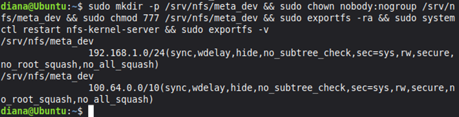  
  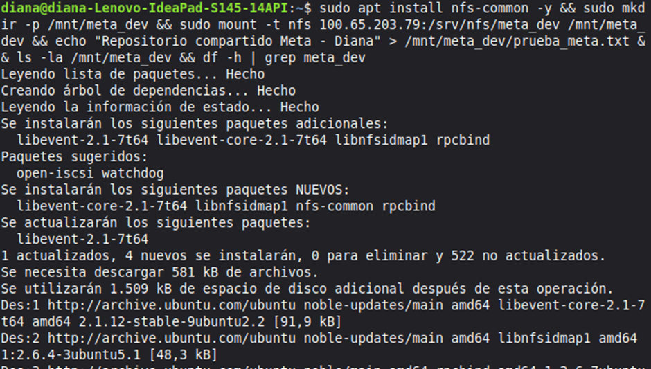

---

## 3. Implementación de NIS (Autenticación Centralizada)

### 3.1 Instalación y Configuración del Servidor Maestro (`meta.local`)
Se instaló el paquete `nis` definiendo el dominio corporativo `meta.local` en `/etc/defaultdomain`, se estableció el rol maestro (`NISSERVER=master`) en `/etc/default/nis` y se restringieron las consultas en `/etc/ypserv.securenets`:

```bash
echo "nis nis/domain string meta.local" | sudo debconf-set-selections
sudo DEBIAN_FRONTEND=noninteractive apt install nis -y
echo "meta.local" | sudo tee /etc/defaultdomain && sudo domainname meta.local

sudo sed -i 's/^#*NISSERVER=.*/NISSERVER=master/' /etc/default/nis
sudo sed -i 's/^#*NISCLIENT=.*/NISCLIENT=false/' /etc/default/nis
printf "255.0.0.0 127.0.0.0\n255.255.255.0 192.168.1.0\n255.192.0.0 100.64.0.0\n" | sudo tee /etc/ypserv.securenets
```

### 3.2 Creación de Usuarios Corporativos, Puerto Estático y Compilación de Mapas
Se creó la cuenta centralizada `meta_user`, se fijó el puerto estático `834` al demonio `ypserv` (`YPSERVARGS="-p 834"`), se compilaron las bases de datos de autenticación y se abrió el puerto `834` en UFW:

```bash
sudo useradd -m -s /bin/bash meta_user && echo "meta_user:Meta2026*" | sudo chpasswd
sudo mkdir -p /var/yp/meta.local && hostname | sudo tee /var/yp/ypservers

sudo sed -i 's/^#*YPSERVARGS=.*/YPSERVARGS="-p 834"/' /etc/default/nis
(grep -q '^YPSERVARGS=' /etc/default/nis || echo 'YPSERVARGS="-p 834"' | sudo tee -a /etc/default/nis)

sudo systemctl restart ypserv && sudo make -C /var/yp
sudo ufw allow from 192.168.1.0/24 to any port 834
sudo ufw allow from 100.64.0.0/10 to any port 834
```

### 3.3 Enlace y Autenticación desde Cliente (Linux Mint)
En el cliente Linux Mint se instaló `nis`, se configuró `/etc/yp.conf` apuntando al servidor maestro `100.65.203.79`, se añadió la resolución `nis` en `/etc/nsswitch.conf` y se validó el enlace y la resolución del usuario `meta_user`:

```bash
sudo apt update
echo "nis nis/domain string meta.local" | sudo debconf-set-selections
sudo DEBIAN_FRONTEND=noninteractive apt install nis -y
echo "meta.local" | sudo tee /etc/defaultdomain && sudo domainname meta.local
echo "domain meta.local server 100.65.203.79" | sudo tee /etc/yp.conf
(grep -q '^passwd:.*nis' /etc/nsswitch.conf || sudo sed -i -E '/^(passwd|group|shadow):/ s/$/ nis/' /etc/nsswitch.conf)

sudo systemctl restart rpcbind ypbind && sleep 2
ypwhich
getent passwd meta_user
```

* **Evidencias:**  
  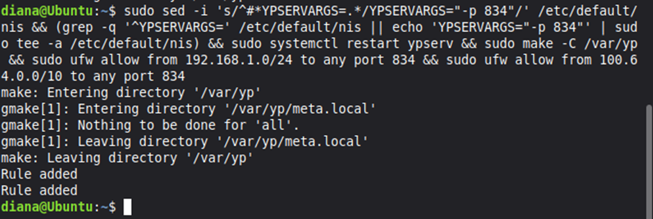  
  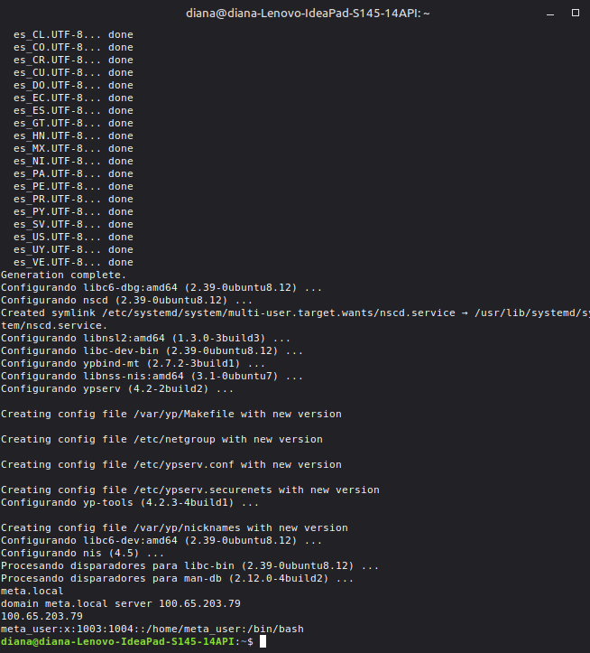

---

## 4. Solución de Problemas Encontrados

| Problema Identificado | Causa Raíz | Solución Aplicada |
| :--- | :--- | :--- |
| **Aislamiento entre clientes en la red inalámbrica local** | El punto de acceso Wi-Fi bloqueaba el tráfico directo entre la estación Linux Mint y la IP local del servidor (`192.168.1.18`). | Se enrutaron los servicios mediante la red VPN Tailscale (`100.65.203.79`, subred `100.64.0.0/10`), autorizando dicho segmento en NTP, NFS, NIS y UFW. |
| **Error `Failed to stat /srv/nfs/meta_dev` al exportar NFS** | El recurso compartido se declaró en `/etc/exports` antes de crear el directorio físico en el sistema de archivos. | Se creó la ruta con `mkdir -p /srv/nfs/meta_dev`, se asignó propiedad `nobody:nogroup` y se recargó la tabla con `exportfs -ra`. |
| **Aviso `RPC: Program not registered` al compilar mapas NIS** | Se ejecutó `make -C /var/yp` antes de que el demonio `ypserv` estuviera activo y registrado en `rpcbind`. | Se asignó el puerto estático `834` en `/etc/default/nis`, se reinició `ypserv` y se recompilaron los mapas sin advertencias. |
| **Error `404 Not Found` al instalar `nis` en Linux Mint** | Los índices locales de paquetes del cliente estaban desactualizados respecto a los repositorios remotos. | Se ejecutó `sudo apt update` previo a la instalación del paquete `nis`. |